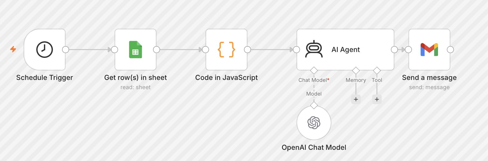
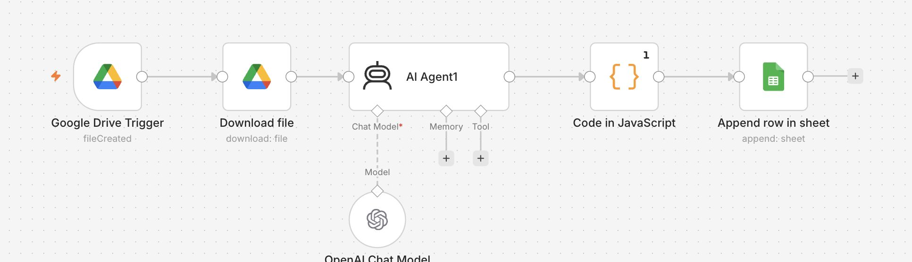

# AI-Powered Sales Reporting & Automation Workflow

## Project Overview

This project uses n8n and AI integration to automate repetitive sales reporting tasks. It connects business data with automated calculations, AI-generated summaries, and email delivery to help stakeholders review sales performance more efficiently.

## Business Problem

Preparing daily sales reports manually can take time and involve repetitive calculations, performance comparisons, and report formatting. This workflow aims to reduce manual effort and deliver structured sales insights consistently.

## Business Objectives

- Automate daily sales report generation and email delivery.
- Monitor sales performance using key performance indicators (KPIs).
- Summarize sales trends and highlight important business results using AI.
- Process sales-related files and organize extracted information in Google Sheets.

## Tools & Technologies

- **n8n:** Workflow automation and integration
- **Google Sheets:** Sales data storage and reporting
- **Google Drive:** File upload and retrieval
- **OpenAI Chat Model:** AI-assisted analysis and summarization
- **JavaScript:** Data transformation and report preparation
- **Gmail:** Automated report delivery

## Workflow 1: Automated Daily Sales Reporting

**Process:** Schedule Trigger → Google Sheets → JavaScript → AI Agent → Gmail

1. **Schedule Trigger:** Starts the workflow at a configured time.
2. **Get Rows in Google Sheets:** Retrieves sales data for reporting.
3. **JavaScript:** Processes the data and prepares sales metrics and structured information.
4. **AI Agent:** Generates a readable summary of sales performance and key highlights.
5. **Gmail:** Sends the formatted sales report automatically by email.

### Report Contents

- Total net sales and gross sales
- Total quantity sold
- Department-wise sales performance
- Month-to-date (MTD) performance
- Top-performing brands
- Brand-wise sales performance
- Key sales highlights and business insights

## Workflow 2: AI-Assisted Sales Data Processing

**Process:** Google Drive Trigger → Download File → AI Agent → JavaScript → Google Sheets

1. **Google Drive Trigger:** Detects a newly created file.
2. **Download File:** Retrieves the uploaded file for processing.
3. **AI Agent:** Processes the file content using the configured AI model.
4. **JavaScript:** Transforms the AI output into a structured format.
5. **Google Sheets:** Appends the processed information to a spreadsheet.

## Business Analyst Skills Demonstrated

- Business process analysis and workflow documentation
- KPI identification and sales performance reporting
- Business reporting automation
- AI-assisted insights and decision support
- Data transformation and structured output handling
- Process improvement and stakeholder communication

## Business Value

- Reduces repetitive manual reporting activities.
- Improves consistency in report preparation.
- Makes sales performance information easier to review.
- Helps stakeholders identify important sales results.
- Creates a repeatable process for reporting and data handling.

## Project Resources

- **Automation Platform:** n8n
- **AI Integration:** OpenAI Chat Model
- **Reporting Channel:** Gmail
- **Data Platform:** Google Sheets and Google Drive

## Screenshots

### 1. Daily Sales Reporting Workflow

### 2. Sales Data Processing Workflow

### 3. Automated Sales Report

## Project Status

This project demonstrates the use of AI and workflow automation for sales reporting and data processing. Implementation details, testing results, and limitations should be updated to reflect the actual workflow.

